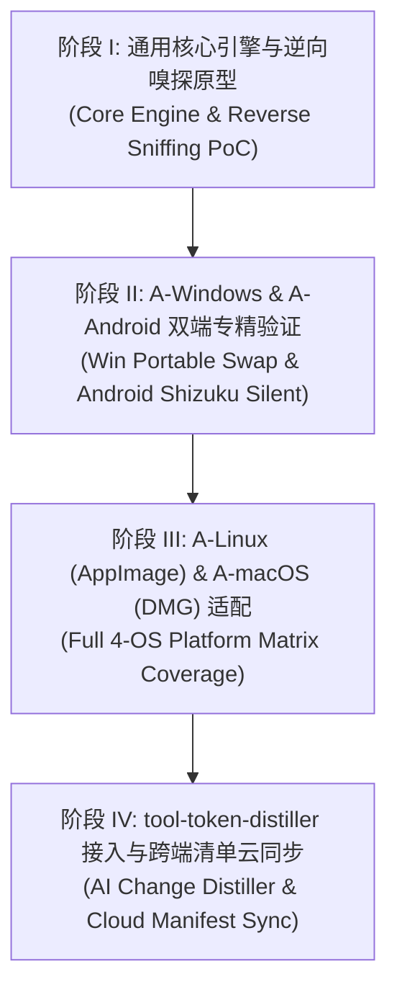

# [未完成状态] tool-omni-updater: 全域开源软件资产自治、逆向嗅探与无感升级中枢
### Universal Autonomous Open-Source Asset Discovery, Reverse Sniffing & Silent Upgrade Hub
**(Cross-Platform: Windows · Linux · Android (APK) · macOS)**

[-orange.svg)](#)
[](https://opensource.org/licenses/MIT)
[](https://python.org)
[](#)

---

## 🌟 项目使命与诞生背景 (Mission & Genesis)

当我们在 GitHub 上获取大量卓越的开源工具（Android APK、Windows 绿色免安装软件、Linux AppImage、macOS 独立应用）时，普遍面临一个极其痛苦的结构性断层：

* **官方开发者不内置更新逻辑**：由于应用商店合规审查限制（Google Play / App Store 严禁私自拉起可执行代码更新）以及维护跨架构分发服务器的高昂成本，超过 90% 的开源作者**主动砍掉**了应用内更新检测功能；
* **与最新版本严重脱节**：使用者必须在软件发生故障或严重落后时，才想起来手动打开浏览器、寻找 Releases 页面重新下载，体验割裂；
* **现有工具的生态孤岛**：
  * `Obtainium` 极其优秀，但**被死死限制在 Android (APK) 领域**；
  * `Topgrade` / `Winget` 依赖包管理器，但**对用户直接从 GitHub 下载的便携绿色软件（Portable Zip / Exe / AppImage）完全无能为力**；
  * 所有工具都需要用户极其繁琐地**去浏览器手动复制粘贴几十次 GitHub 网址**。

**`tool-omni-updater` 为终结这一混沌状态而生**：  
它是一个跨 **Windows、Linux、Android、macOS** 四大操作系统的全域开源软件资产治理中枢，致力于实现：  
**“本地资产一键逆向嗅探 ➔ 零 Token 消耗极速发布感知 ➔ 平台专精无感静默覆写 ➔ AI 变更日志精炼与避坑预警”** 的完整闭环。

---

## 🏛️ 技术思想溯源与全球对标矩阵 (World-Class Heritage & Prior Art)

本项目秉持“吸收成熟经验、批判继承、攻坚全球空白”的原则，在架构推导之初，通过 `tool-omniscout-radar` 对全球标杆项目进行了深度解构与五维量规审计：

| 权威源流 / 开源基座 | 源流定位 | 核心机制突破 (Distilled Mechanics) | 本项目吸收与借鉴要点 | 超越点与取舍 (Trade-offs & Innovations) |
| :--- | :--- | :--- | :--- | :--- |
| **[ImranR98/Obtainium](https://github.com/ImranR98/Obtainium)** [^1] | `ANDROID_GOLD_STANDARD` (⭐ 20k) | 直接从源头（GitHub/GitLab）获取更新，模糊正则匹配设备 CPU ABI | 吸收其经过数万人敲打的资产决议评分加权算法与版本语义比较模型 | 彻底打破其仅限 Android 的狭隘边界，重构为跨 Windows/Linux/macOS 的通用抽象内核 |
| **[topgrade-rs/topgrade](https://github.com/topgrade-rs/topgrade)** [^2] | `ORCHESTRATOR_CLI` (⭐ 4.6k) | 抽象提供者模式（Provider Pattern），统一调度异构系统的更新事务 | 吸收其高度解耦的调度架构，使各平台执行器职责单一化 | 突破其只能依赖系统包管理器的局限，专门攻坚直接来自 GitHub Releases 的独立绿色资产 |
| **[RikkaApps/Shizuku](https://github.com/RikkaApps/Shizuku)** [^3] | `ANDROID_IPC_KERNEL` (⭐ 30.7k) | 通过免 Root 无线调试提权，调用底座 Binder IPC 执行无交互系统操作 | 吸收其与 Android `PackageInstaller.Session` 的静默无感安装通信机制 | 仅作为 Android 端专属加速插槽，不侵入通用核心逻辑 |
| **[velopack/velopack](https://github.com/velopack/velopack)** [^4] | `DESKTOP_RUNTIME` (⭐ 2.4k) | 跨 Windows/Linux/macOS 桌面更新运行时，攻克运行中文档锁 | 吸收其 Windows 平台 `Rename -> Replace -> Delete` 绕过正在运行文件锁的原子机制 | 从“开发者内嵌式”升维为“面向全系统第三方开源软件的外部自治管家” |
| **[crazy-max/diun](https://github.com/crazy-max/diun)** [^5] | `SERVER_NOTIFIER` (⭐ 4.9k) | 高并发轻量发布轮询与多通道低延迟广播（Webhook/Telegram/Bark） | 吸收其基于 ETag 与 If-None-Match 的零负载变动探测设计 | 补全其“只负责发通知、缺乏客户端真实安装覆写”的下半程链条 |

### 📚 权威引用与事实锚点 (Normative Footnotes)
[^1]: **ImranR98/Obtainium**: [https://github.com/ImranR98/Obtainium](https://github.com/ImranR98/Obtainium). *Get Android app updates straight from the source.*
[^2]: **topgrade-rs/topgrade**: [https://github.com/topgrade-rs/topgrade](https://github.com/topgrade-rs/topgrade). *Universal multi-package-manager upgrader.*
[^3]: **RikkaApps/Shizuku**: [https://github.com/RikkaApps/Shizuku](https://github.com/RikkaApps/Shizuku). *Using system APIs directly with ADB/root privileges through Binder IPC.*
[^4]: **velopack/velopack**: [https://github.com/velopack/velopack](https://github.com/velopack/velopack). *Zero-dependency cross-platform desktop installer and auto-updater.*
[^5]: **crazy-max/diun**: [https://github.com/crazy-max/diun](https://github.com/crazy-max/diun). *Receive notifications when an upstream image or release is updated.*

---

## ⚡ 四大杀手级独创突破 (The 4 Killer Innovations)

为什么全世界已经有了这些工具，我们依然必须打造 `tool-omni-updater`？因为以下四大痛点目前全球尚无任何成熟解法：

```
┌────────────────────────────────────────────────────────────────────────┐
│                   tool-omni-updater 四大颠覆式创新架构                  │
├──────────────────────────────────┬─────────────────────────────────────┤
│ 1. 零配置本地资产反向逆向嗅探   │ 告别手动复制粘贴 50 个 URL，一键全盘 │
│    (Reverse Asset Sniffing)      │ 扫描 PE/ELF/Manifest 自动对齐上游    │
├──────────────────────────────────┼─────────────────────────────────────┤
│ 2. 终结 PC 绿色免安装软件更新黑洞│ Windows/Linux 独立 zip/exe/AppImage  │
│    (Portable App In-Place Patch) │ 首次获得自动追踪与原子原地热替换能力│
├──────────────────────────────────┼─────────────────────────────────────┤
│ 3. 挂载 AI 变更提纯与高危预警    │ 联动 tool-token-distiller，将千字更新 │
│    (Breaking Changes Guard)      │ 提纯为 3 句话，拦截破坏性配置文件变动│
├──────────────────────────────────┼─────────────────────────────────────┤
│ 4. 全端统一软件清单云同步        │ 手机与 PC 共享同一套开源资产清单，换 │
│    (Cross-Device Manifest Sync)  │ 机重装一键全自动拉取最新构建包      │
└──────────────────────────────────┴─────────────────────────────────────┘
```

### 1. 零配置的“本地资产反向逆向嗅探”（Reverse Asset Sniffing）
* **痛点**：传统工具最折磨人的地方在于——你有 40 个软件，必须在浏览器搜 40 次并手动粘贴 40 次 GitHub 网址。
* **突破**：用户仅需指定本地目录（如 `D:\Tools` 或 Android 应用列表），系统通过解析可执行文件的 **PE VersionInfo、Linux ELF 静态字符串、Android PackageName**，结合 GitHub API 指纹库进行反向逆向推导，**秒级自动生成纳管监控清单**！

### 2. 填补桌面端空白：绿色开源便携软件的无感热覆写
* 攻克 Windows 操作系统在程序运行中锁定 `.exe` 导致无法覆盖的顽疾；
* 利用轻量临时重命名技术与进程退出回调，实现 Windows/Linux 便携软件后台无感平滑升级。

### 3. 集成 AI 变更日志提纯与破坏性变更高危预警（Breaking Changes Guard）
* 直接挂载内部已沉淀的 **`tool-token-distiller`** 算法；
* 自动将开发者冗长的几千行 Release Notes 提纯为高信噪比卡片：
  * **✨ 核心新功能** (Feature Highlights)
  * **🐛 关键修复** (Critical BugFixes)
  * **⚠️ 破坏性变更警告** (Breaking Changes Alert：例如配置文件格式重构、依赖废弃提示)。

### 4. 平台解耦专精微逻辑（Platform-Specialized Micro-Runners）
* 拒绝大一统代码膨胀，核心引擎统一，执行器按平台物理拆分：
  * **A-Android**：专精 `.apk` 过滤与 `Shizuku` 后台全自动静默安装；
  * **A-Windows**：专精 `.exe`/`.msi`/`.zip` 解析与文件锁穿透；
  * **A-Linux**：专精 `AppImage` 覆盖与 `chmod +x` 自动赋权；
  * **A-macOS**：专精 `.dmg` 静默挂载与 Gatekeeper 隔离移除（`xattr -cr`）。

---

## 🗺️ 架构路线图 (Architecture Roadmap)



* **[ ] Phase 1 (Core)**: 共享核心算法库（GitHub Atom Feed 零 Token 轮询解析器、SemVer 版本数学计算、定时调度队列）；
* **[ ] Phase 2 (Desktop & Mobile)**: 交付 `A-Windows` 绿色软件原地原子替换运行器与 `A-Android` Shizuku 适配器；
* **[ ] Phase 3 (POSIX Ecosystem)**: 交付 `A-Linux` AppImage 管理器与 `A-macOS` 自动挂载安装器；
* **[ ] Phase 4 (AI & Sync)**: 挂载 `tool-token-distiller` 提纯管道，支持生成全局备份与跨设备同步清单。

---

## 🚫 明确不做的事 (Non-Goals)

1. **坚决不做封闭式中心化应用商店**：本项目不维护任何中心化审核分发服务器，所有数据 100% 直连开源软件的第一发布源（Direct from the source）；
2. **坚决不侵入系统级成熟包管理器领域**：不尝试替代 `apt`、`pacman` 或已由 `winget` 完美托管的商店类官方软件，专精于“直接从 GitHub 发版的独立/绿色开源资产”这一全球盲区；
3. **坚决不做臃肿的跨平台单一全家桶二进制**：坚决贯彻平台解耦微逻辑，各端保持极致的轻量与独立纯粹。

---

> **当前状态标注**：本项目目前处于 **`[未完成状态]`** 构思立项与架构推导阶段，已锁定核心不变量与技术事实账本。详细技术演进请参见随附的 `.provenance.json` 与 `CORE_INVARIANTS.md`。
